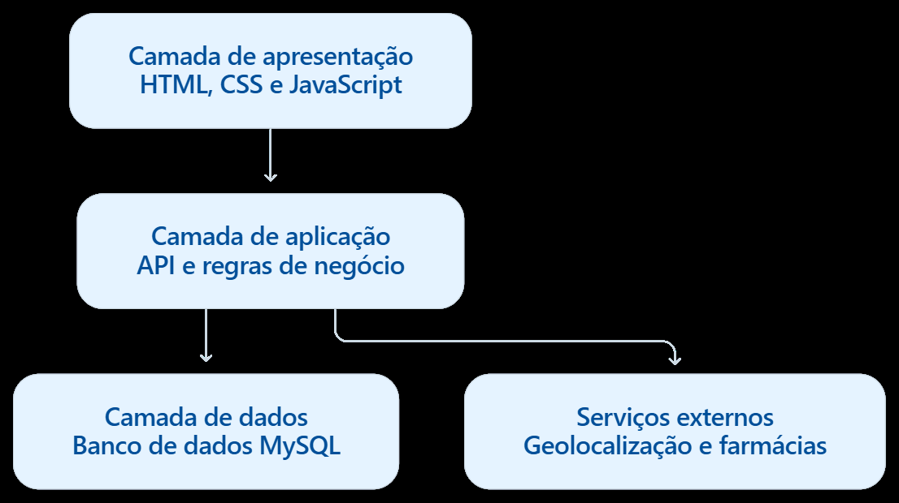
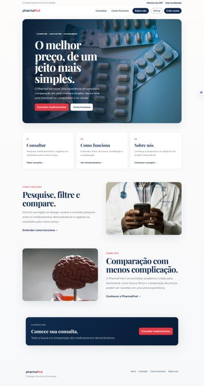
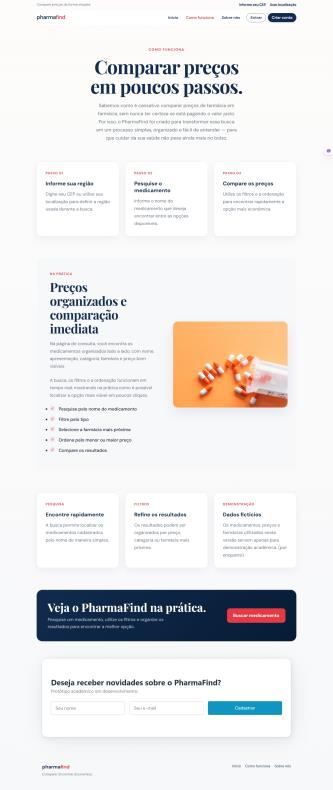
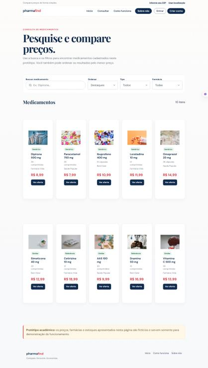
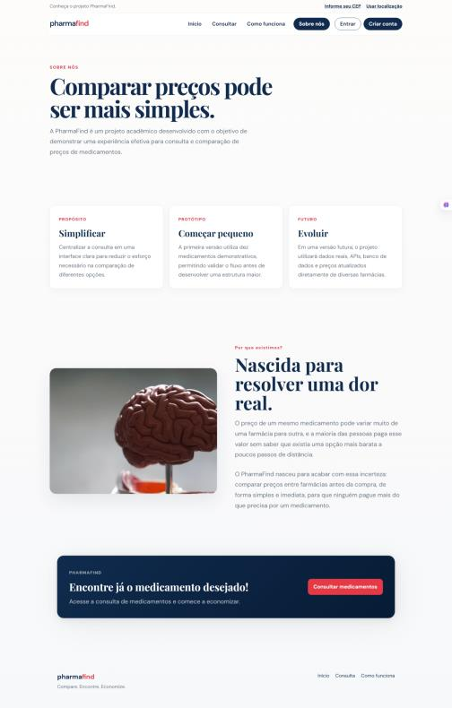

# Documento de Visão do Produto — PharmaFind (v2.0)

**Centro Universitário do Planalto Central Aparecido dos Santos – UNICEPLAC**  
**Disciplina:** Programação Web  
**Registro histórico:** outubro de 2026

> Fonte: `DOC.PharmaFind.pdf`. Numeração atribuída para organização retrospectiva. Conversão editorial para Markdown do conteúdo preenchido, sem exemplos/instruções do formulário, sem elementos decorativos, sem matrículas e e-mails pessoais (repositório público). Não constitui nova aprovação nem reproduz assinaturas digitais. Consulte a [evolução documental](README.md) e a [SPEC vigente](../SPEC.md) para distinguir visão histórica de especificação técnica atual.

## 1. Identificação do grupo e da disciplina

| Campo | Valor |
| --- | --- |
| Curso | Análise e Desenvolvimento de Sistemas |
| Disciplina | Programação Web |
| Professor(a) | Romes Heriberto Araújo |
| Turma | ANAD4N1 |
| Turno | Noturno |
| Semestre / Período | 4º |
| Nome do grupo | PharmaFind |
| Data de entrega | A definir |

### Integrantes do grupo

| # | Nome completo | Função no grupo |
| --- | --- | --- |
| 1 | Everton Gabriel da Cunha | Dev Full Stack |
| 2 | Júlia Gabrielle da Silva Lima | Analista de requisitos |
| 3 | Lucas dos Santos Bezerra | Dev Full Stack |
| 4 | Lucas Marques Almeida | Scrum Master |
| 5 | Roberto Carlos Martins | Product Owner |
| 6 | Tainá do Amaral Melo | Dev Full Stack |

## 2. Identificação da solução (aplicação web)

| Campo | Valor |
| --- | --- |
| Nome da solução / Site | PharmaFind |
| Slogan ou frase de efeito | O melhor preço, de um jeito mais simples. |
| Categoria / tipo de aplicação web | Portal de busca e comparação de medicamentos. |
| Endereço/domínio pretendido | `www.PharmaFind.com.br` |
| Responsividade | Sim (celular, tablet e desktop) |
| Navegadores suportados | Google Chrome, Microsoft Edge, Mozilla Firefox e Safari, em versões atualizadas. |
| Modelo de acesso | Gratuito |

## 3. Contextualização: problema e oportunidade

### Qual problema a aplicação pretende resolver?

O PharmaFind busca resolver a dificuldade de encontrar rapidamente um medicamento pelo menor preço possível e em uma farmácia próxima, evitando que o usuário precise pesquisar individualmente em vários estabelecimentos.

### Quem é afetado por esse problema e de que forma?

Consumidores que precisam localizar um medicamento e desejam evitar a pesquisa manual em várias farmácias. Esses usuários podem perder tempo comparando preços e endereços separadamente, principalmente quando precisam encontrar uma opção próxima e com preço mais baixo.

### Qual a oportunidade (por que agora / por que vale a pena resolver)?

A oportunidade está no fato de que ainda há dificuldade para encontrar, em um único lugar, informações claras sobre preço e proximidade de farmácias. Essa é uma necessidade comum entre consumidores que precisam pesquisar o mesmo medicamento em diferentes estabelecimentos para encontrar uma opção mais econômica. O PharmaFind busca simplificar esse processo, reunindo essas informações em uma única busca e tornando a comparação mais rápida e prática.

## 4. Objetivo da aplicação

### Objetivo geral

Permitir que o usuário pesquise um medicamento e compare as opções disponíveis em diferentes farmácias, considerando principalmente o preço e a proximidade.

### Objetivos específicos

1. Permitir a pesquisa de medicamentos pelo nome.
2. Exibir as farmácias que possuem oferta cadastrada para o medicamento pesquisado e seus respectivos preços.
3. Permitir o uso de CEP ou geolocalização autorizada para identificar a posição aproximada do usuário.
4. Exibir e ordenar as farmácias por menor preço e por menor distância.
5. Apresentar informações básicas da farmácia, como endereço, distância e horário de funcionamento, quando disponíveis.

## 5. Alinhamento com os ODS (Agenda 2030 – ONU)

- ODS principal: ODS 03 — Saúde e Bem-Estar.
- ODS secundário: Não definido (opcional).

O projeto se relaciona principalmente ao ODS 03 por facilitar o acesso do usuário a informações de preço e localização de farmácias para um medicamento já procurado por ele. O PharmaFind não orienta tratamentos nem recomenda qual medicamento usar, sua contribuição está em tornar a busca por informações de compra mais simples e acessível.

## 6. Justificativa: relevância e utilidade

### Relevância — por que esta aplicação importa?

O PharmaFind é relevante porque devolve ao usuário o poder de decisão ao reunir preços, farmácias e tipos de medicamento num só lugar, a aplicação transforma uma escolha antes dispersa e pouco clara em algo rápido, transparente e economicamente consciente, além de demonstrar, na prática organização de dados, usabilidade e design orientado à decisão do usuário.

### Utilidade — o que o usuário ganha ao usá-la?

O usuário ganha praticidade ao consultar, em um único local, onde o medicamento pesquisado está disponível, qual o preço informado e qual a distância aproximada até a farmácia. Assim, pode decidir com mais rapidez qual opção atende melhor à sua situação.

## 7. Público-alvo

| Característica | Descrição |
| --- | --- |
| Faixa etária | 18 anos ou mais |
| Perfil / ocupação | Consumidores e responsáveis por compras de medicamentos no Gama e região. |
| Contexto de uso (onde/como acessam) | Acesso por desktop, tablet ou dispositivo móvel com conexão à internet. |
| Necessidades principais | Encontrar rapidamente um medicamento, comparar preços e identificar farmácias próximas. |
| Familiaridade com tecnologia | Média |

## 8. Personas

### Persona 1

| Campo | Descrição |
| --- | --- |
| Nome fictício | Leonardo da Silva |
| Idade | 45 |
| Ocupação | Gerente de loja |
| Contexto / rotina | Passa o dia todo trabalhando, só consegue mexer no celular no horário de almoço |
| Objetivos | Encontrar com rapidez onde adquirir o medicamento que seu filho já utiliza, considerando preço e distância. |
| Frustrações / dores | Pouco tempo para pesquisar e preços diferentes entre farmácias. |
| Como a aplicação ajuda esta persona | O PharmaFind permite comparar as ofertas cadastradas e visualizar quais farmácias estão mais próximas. |
| Familiaridade com tecnologia | Média |

### Persona 2

| Campo | Descrição |
| --- | --- |
| Nome fictício | Ana Lima |
| Idade | 25 |
| Ocupação | Caixa de mercado |
| Contexto / rotina | Trabalha meio período e estuda a noite |
| Objetivos | Organizar sua rotina e encontrar rapidamente uma farmácia próxima com preço acessível para o medicamento que procura. |
| Frustrações / dores | Pouco tempo disponível para consultar várias farmácias e comparar preços manualmente. |
| Como a aplicação ajuda esta persona | O sistema reúne as opções encontradas e mostra preço, endereço e distância, reduzindo o tempo gasto na pesquisa. |
| Familiaridade com tecnologia | Alta |

## 9. Mapa de empatia (uma persona)

| Quadrante | Descrição |
| --- | --- |
| O que pensa e sente? | Quer economizar sem perder tempo pesquisando farmácia por farmácia e deseja saber se existe uma opção próxima. |
| O que vê? | Preços diferentes para o mesmo medicamento, várias farmácias na região e informações espalhadas em fontes diferentes. |
| O que ouve? | Orientações do profissional de saúde sobre o medicamento já indicado e comentários de familiares sobre diferenças de preço entre farmácias. |
| O que fala e faz? | Pesquisa pelo celular, compara valores e endereços e tenta escolher uma opção que equilibre preço e deslocamento. |
| Dores | Pouco tempo para pesquisar; receio de pagar mais caro; dificuldade para descobrir qual farmácia está mais próxima. |
| Ganhos | Encontrar rapidamente o menor preço informado e a farmácia mais próxima, com informações claras em uma única consulta. |

## 10. Jornada do usuário e fluxo de navegação

| Etapa | Ação do usuário | O que a aplicação faz / exibe |
| --- | --- | --- |
| 1 | Acessa o PharmaFind. | A aplicação exibe a página inicial com o campo de pesquisa. |
| 2 | Digite o nome do medicamento e inicia a busca. | O sistema localiza o medicamento e exibe as ofertas cadastradas. |
| 3 | Informa o CEP ou autoriza a geolocalização. | O sistema determina a localização aproximada para calcular/obter a proximidade das farmácias. |
| 4 | Consulta os resultados. | A aplicação mostra farmácia, preço, endereço e distância aproximada. |
| 5 | Ordena por menor preço ou menor distância. | O sistema reorganiza os resultados conforme o critério escolhido. |
| 6 | Analisa a opção desejada. | A aplicação exibe os dados da farmácia para que o usuário decida onde realizar a compra fora do PharmaFind. |

## 11. Análise de concorrentes e sites similares

| Site | Pontos fortes | Pontos fracos | Nosso diferencial |
| --- | --- | --- | --- |
| Buscapé | É um comparador de preços consolidado, reunindo ofertas de diferentes lojas e facilitando a comparação de valores. | É uma plataforma generalista e não tem como foco principal a comparação local entre preço de medicamento e distância até uma farmácia. | O PharmaFind será focado em medicamentos e reunirá preço e proximidade da farmácia na mesma busca. |
| Zoom | Oferece comparação de preços e recursos de apoio à decisão de compra em diferentes categorias de produtos. | Seu foco é amplo e voltado ao varejo em geral, sem priorizar a localização de farmácias para uma busca específica de medicamento. | O PharmaFind terá uma experiência mais objetiva, limitada ao contexto de medicamentos, preço e localização de farmácias. |
| Google Maps | Permite localizar estabelecimentos próximos, visualizar endereços, rotas e horários de funcionamento. | Não compara, de forma estruturada, o preço de um medicamento específico entre as farmácias encontradas. | O PharmaFind combinará a localização das farmácias com as ofertas cadastradas do medicamento pesquisado. |

## 12. Proposta de valor e diferencial

O diferencial do PharmaFind está em reunir, em uma única busca, informações sobre preço e localização de medicamentos em diferentes farmácias. Em vez de o usuário precisar consultar vários sites ou estabelecimentos separadamente, o sistema permite comparar as opções disponíveis e identificar de forma rápida onde o medicamento está mais barato e qual farmácia está mais próxima, utilizando CEP ou geolocalização.

## 13. Resumo da solução (elevator pitch)

Para consumidores que precisam encontrar um medicamento sem pesquisar farmácia por farmácia, o PharmaFind é um buscador web que reúne preços e localização de estabelecimentos. Diferentemente de comparadores genéricos ou serviços de mapas usados separadamente, a solução apresenta preço e proximidade na mesma consulta, sem realizar vendas dentro da plataforma.

## 14. Funcionalidades e escopo do MVP

Prioridades: A = Alta, M = Média, B = Baixa. MVP: S = Sim, N = Não.

| # | Funcionalidade | Descrição resumida | Prioridade | MVP? |
| --- | --- | --- | --- | --- |
| 1 | Pesquisa de medicamento | Buscar medicamentos pelo nome. | A | S |
| 2 | Consulta de ofertas | Listar as farmácias com oferta cadastrada para o medicamento. | M | S |
| 3 | Comparação de preços | Exibir e ordenar os resultados pelo menor preço. | A | S |
| 4 | Localização por CEP | Permitir que o usuário informe um CEP para definir sua região. | A | S |
| 5 | Geolocalização | Utilizar a localização do navegador somente após autorização do usuário. | A | S |
| 6 | Comparação por distância | Exibir a distância aproximada e ordenar as farmácias da mais próxima para a mais distante. | A | S |
| 7 | Dados da farmácia | Exibir nome, endereço e horário de funcionamento, quando disponível. | A | S |
| 8 | Login do usuário | Simular a entrada do usuário no sistema através de um formulário de e-mail e senha, armazenando os dados localmente no navegador para personalizar a experiência sem a necessidade de um servidor. | B | N |
| 9 | Cadastro de alertas por e-mail | Permitir que o usuário informe seu e-mail para receber notificações sobre promoções, quedas de preço e disponibilidade de medicamentos de seu interesse. | B | N |
| 10 | Histórico de buscas | Guardar localmente os últimos medicamentos pesquisados, facilitando consultas recorrentes (ex: tratamentos contínuos). | B | N |
| 11 | Favoritar medicamentos | Permitir marcar medicamentos como favoritos para acesso rápido, sem precisar refazer a busca toda vez. | B | N |
| 12 | Comparador lado a lado | Selecionar dois ou mais medicamentos (ou tipos: Genérico vs. Referência) e exibir a diferença de preço e economia estimada em uma tabela. | B | N |
| 13 | Modo Escuro | Alternar entre tema claro e escuro, mantendo a identidade visual (azul-marinho/vermelho) adaptada. | B | N |
| 14 | Avaliação de farmácias | Exibir uma nota simulada (estrelas) por farmácia, baseada em critérios como atendimento ou confiabilidade de preço. | B | N |

## 15. Mapa do site (sitemap) e páginas

| Página | Objetivo da página | Requer login? |
| --- | --- | --- |
| Home | Apresentar o PharmaFind e disponibilizar a busca principal. | Não |
| Busca / Resultados | Mostrar as ofertas encontradas e permitir ordenação por preço ou distância. | Não |
| Detalhes do medicamento | Exibir informações básicas do medicamento e as ofertas vinculadas. | Não |
| Detalhes da farmácia | Exibir nome, endereço, distância e horário de funcionamento. | Não |
| Como funciona | Explicar o fluxo de busca, comparação e uso da localização. | Não |
| Sobre / Contato | Apresentar o objetivo do projeto e informações institucionais. | Não |
| Privacidade / Termos | Informar como CEP/geolocalização são utilizados e esclarecer os limites do serviço. | Não |

## 16. Requisitos funcionais (RF)

| ID | Requisito funcional | Prioridade |
| --- | --- | --- |
| RF01 | O sistema deverá permitir que o usuário pesquise um medicamento pelo nome. | Alta |
| RF02 | O sistema deverá aceitar pesquisas por nome completo ou parcial do medicamento. | Média |
| RF03 | O sistema deverá permitir que o usuário selecione o medicamento desejado entre os resultados encontrados. | Alta |
| RF04 | O sistema deverá exibir informações básicas do medicamento selecionado, conforme os dados cadastrados. | Média |
| RF05 | O sistema deverá listar as farmácias que possuam oferta cadastrada para o medicamento pesquisado. | Alta |
| RF06 | O sistema deverá exibir o preço informado para o medicamento em cada farmácia. | Alta |
| RF07 | O sistema deverá comparar os preços das ofertas encontradas para o mesmo medicamento. | Alta |
| RF08 | O sistema deverá permitir ordenar as ofertas do menor para o maior preço. | Alta |
| RF09 | O sistema deverá destacar o menor preço encontrado entre as ofertas válidas. | Alta |
| RF10 | O sistema deverá permitir que o usuário informe um CEP. | Alta |
| RF11 | O sistema deverá validar o formato do CEP informado antes de utilizá-lo. | Alta |
| RF12 | O sistema deverá solicitar autorização antes de acessar a geolocalização do dispositivo. | Alta |
| RF13 | O sistema deverá utilizar a geolocalização somente quando o usuário autorizar o acesso. | Alta |
| RF14 | O sistema deverá permitir o uso do CEP quando a geolocalização não estiver disponível ou não for autorizada. | Alta |
| RF15 | O sistema deverá identificar as farmácias próximas à localização informada pelo usuário. | Alta |
| RF16 | O sistema deverá calcular ou obter a distância aproximada entre o usuário e as farmácias encontradas. | Alta |
| RF17 | O sistema deverá exibir a distância aproximada de cada farmácia nos resultados. | Alta |
| RF18 | O sistema deverá permitir ordenar as farmácias da menor para a maior distância. | Alta |
| RF19 | O sistema deverá destacar qual farmácia está mais próxima da localização utilizada na busca. | Alta |
| RF20 | O sistema deverá exibir o nome e o endereço da farmácia em cada resultado. | Alta |
| RF21 | O sistema deverá exibir o horário de funcionamento da farmácia quando essa informação estiver cadastrada. | Alta |
| RF22 | O sistema deverá informar a quantidade de ofertas encontradas para o medicamento pesquisado. | Média |
| RF23 | O sistema deverá apresentar uma mensagem clara quando nenhuma oferta for encontrada. | Alta |
| RF24 | O sistema deverá permitir que o usuário realize uma nova pesquisa sem precisar reiniciar a aplicação. | Alta |
| RF25 | O sistema deverá manter o termo pesquisado visível na tela de resultados. | Baixa |
| RF26 | O sistema deverá armazenar os dados dos medicamentos necessários às consultas. | Alta |
| RF27 | O sistema deverá armazenar os dados das farmácias, incluindo endereço, CEP e coordenadas quando disponíveis. | Alta |
| RF28 | O sistema deverá relacionar cada oferta a um medicamento e a uma farmácia. | Alta |
| RF29 | O sistema deverá permitir a atualização do preço e da disponibilidade de uma oferta. | Alta |
| RF30 | O sistema deverá informar que preços e disponibilidade podem sofrer alterações e apresentar a data de atualização quando disponível. | Alta |

## 17. Requisitos não funcionais (RNF)

| ID | Categoria | Requisito não funcional |
| --- | --- | --- |
| RNF01 | Interface e usabilidade | O sistema deverá funcionar adequadamente em smartphones, tablets e computadores. |
| RNF02 | Interface e usabilidade | Os componentes deverão se reorganizar de acordo com o tamanho da tela. |
| RNF03 | Interface e usabilidade | O conteúdo principal não deverá exigir rolagem horizontal em telas compatíveis. |
| RNF04 | Interface e usabilidade | A interface deverá ser simples, objetiva e adequada a usuários com diferentes níveis de familiaridade tecnológica. |
| RNF05 | Interface e usabilidade | As páginas deverão manter padrão consistente de cores, tipografia, botões, campos e espaçamentos. |
| RNF06 | Interface e usabilidade | Os textos deverão possuir tamanho, contraste e espaçamento que favoreçam a leitura. |
| RNF07 | Interface e usabilidade | Mensagens de erro, ausência de resultados e orientações deverão utilizar linguagem clara. |
| RNF08 | Desempenho | No ambiente acadêmico de testes, as páginas principais deverão carregar em até 3 segundos em condições normais de rede. |
| RNF09 | Desempenho | As buscas no conjunto de dados de teste deverão retornar resultados em até 3 segundos. |
| RNF10 | Acessibilidade | As páginas deverão utilizar HTML semântico sempre que existir um elemento apropriado. |
| RNF11 | Acessibilidade | Todos os campos de formulário deverão possuir rótulos associados. |
| RNF12 | Acessibilidade | Links, botões e campos do fluxo principal deverão ser utilizáveis apenas com o teclado. |
| RNF13 | Acessibilidade | O foco do teclado deverá permanecer visível durante a navegação. |
| RNF14 | Acessibilidade | Imagens informativas deverão possuir texto alternativo adequado. |
| RNF16 | Acessibilidade | A estrutura e as mensagens principais deverão ser compatíveis com leitores de tela. |
| RNF17 | Acessibilidade | O idioma principal das páginas deverá ser definido como pt-BR. |
| RNF18 | Acessibilidade | ARIA deverá ser utilizada apenas quando elementos HTML semânticos não forem suficientes. |
| RNF19 | Segurança e privacidade | A geolocalização somente poderá ser acessada após autorização explícita do usuário. |
| RNF20 | Segurança e privacidade | O sistema deverá coletar somente os dados necessários à busca, como CEP ou localização aproximada. |
| RNF21 | Segurança e privacidade | A localização precisa não deverá ser armazenada permanentemente sem necessidade e consentimento específico. |
| RNF22 | Segurança e privacidade | Em ambiente de produção, a comunicação deverá utilizar HTTPS. |
| RNF23 | Segurança e privacidade | Entradas de pesquisa, CEP e demais dados deverão ser validados também no servidor. |
| RNF24 | Segurança e privacidade | As consultas ao banco deverão utilizar comandos parametrizados ou mecanismos equivalentes contra injeção de SQL. |
| RNF25 | Segurança e privacidade | Dados exibidos na interface deverão ser tratados para reduzir riscos de injeção de conteúdo e XSS. |
| RNF26 | Segurança e privacidade | O MVP não deverá solicitar CPF, telefone ou outros dados pessoais sem necessidade funcional. |
| RNF27 | Banco de dados | Os relacionamentos entre medicamentos, farmácias e ofertas deverão ser protegidos por chaves estrangeiras. |
| RNF28 | Banco de dados | Cada registro principal deverá possuir um identificador único. |
| RNF29 | Banco de dados | Uma oferta atual deverá representar uma combinação válida entre um medicamento e uma farmácia. |
| RNF30 | Banco de dados | Os preços deverão ser armazenados com tipo numérico apropriado para valores monetários e duas casas decimais. |
| RNF31 | Banco de dados | O CEP deverá ser validado no formato brasileiro de oito dígitos antes de ser utilizado. |
| RNF32 | Banco de dados | Latitude e longitude, quando armazenadas, deverão possuir precisão suficiente para o cálculo de proximidade. |
| RNF33 | Banco de dados | Toda oferta deverá possuir data de atualização válida quando esse controle for utilizado. |
| RNF34 | Compatibilidade | O sistema deverá funcionar nas versões atuais dos principais navegadores modernos suportados pelo projeto. |
| RNF35 | Compatibilidade | O fluxo principal deverá permanecer utilizável em dispositivos móveis com conexão de internet comum. |
| RNF36 | Manutenibilidade | O código deverá seguir o padrão MVC, separando visualização, controle, regras de negócio e persistência. |
| RNF37 | Manutenibilidade | O código-fonte deverá ser versionado e as alterações relevantes deverão ser registradas no repositório do projeto. |
| RNF38 | Confiabilidade | Falhas de consulta ao banco, localização ou integração externa deverão apresentar mensagens tratadas ao usuário. |
| RNF39 | Confiabilidade | Quando nenhuma oferta existir, o sistema deverá apresentar estado vazio sem quebrar o layout. |
| RNF40 | Confiabilidade | Se a geolocalização falhar, o usuário deverá poder continuar utilizando a busca por CEP. |
| RNF41 | Transparência | O sistema deverá deixar claro que preço e disponibilidade podem variar após a última atualização dos dados. |
| RNF42 | Manutenibilidade | Regras principais de busca, comparação de preço e distância deverão ser documentadas para facilitar testes e manutenção. |

> Nota de conversão: o identificador RNF15 não consta no PDF; a numeração original foi preservada.

## 18. Acessibilidade web (WCAG 2.1)

| Princípio | Boa prática | Como o nosso projeto vai atender |
| --- | --- | --- |
| Perceptível | Toda imagem informativa tem texto alternativo (alt); vídeos têm legendas. | Imagens informativas terão atributo alt; elementos meramente decorativos não serão anunciados ao leitor de tela. |
| Perceptível | Contraste entre texto e fundo de no mínimo 4,5:1; não usar só a cor para transmitir informação. | A paleta será validada para contraste mínimo de 4,5:1 em texto comum e a informação não dependerá apenas de cor. |
| Operável | Tudo é acessível pelo teclado (Tab), com foco visível; sem “armadilhas” de teclado. | O fluxo principal será testado com a tecla Tab, mantendo ordem lógica e foco visível. |
| Operável | Links e botões têm textos descritivos (evitar “clique aqui”); áreas de clique adequadas. | Botões e links terão textos ou nomes acessíveis que indiquem claramente sua função. |
| Compreensível | Formulários com `<label>` associado, mensagens de erro claras e instruções de preenchimento. | Campos de pesquisa e CEP terão `<label>`, instruções e mensagens de erro objetivas. |
| Compreensível | Idioma da página definido (`lang="pt-BR"`); navegação e rótulos consistentes. | As páginas utilizarão `lang="pt-BR"` e manterão os mesmos nomes para ações equivalentes. |
| Robusto | HTML semântico (header, nav, main, footer, button); uso de ARIA apenas quando necessário. | Serão utilizados elementos semânticos como header, nav, main, form, button e footer; ARIA apenas quando necessário. |
| Robusto | Compatível com leitores de tela (ex.: NVDA, VoiceOver) e diferentes navegadores. | O grupo testará o fluxo principal em navegador moderno e com leitor de tela, buscando conformidade AA da WCAG 2.1. |

### Compromissos de acessibilidade do grupo

O grupo se compromete a implementar navegação por teclado, foco visível, labels em formulários, contraste adequado, HTML semântico e textos alternativos. O fluxo de pesquisa será testado por teclado e com ferramenta de contraste; quando possível, também será validado com leitor de tela, tendo como referência o nível AA da WCAG 2.1.

## 19. Regras de negócio

| ID | Regra de negócio |
| --- | --- |
| RN01 | Uma oferta deverá estar vinculada a exatamente um medicamento e uma farmácia e possuir um preço válido. |
| RN02 | A comparação de preços deverá considerar somente ofertas válidas e disponíveis no conjunto de dados consultado. |
| RN03 | A localização do usuário deverá ser obtida por CEP informado ou por geolocalização autorizada; sem autorização, o CEP será a alternativa, se autorizado. |
| RN04 | O sistema poderá destacar separadamente o menor preço e a farmácia mais próxima; a escolha final permanecerá com o usuário. |
| RN05 | O PharmaFind não realizará venda, pagamento, reserva ou pedido e não recomendará qual medicamento o usuário deve utilizar. |

## 20. Arquitetura da solução (web)

O PharmaFind utilizará uma arquitetura cliente-servidor em três camadas, separando a interface, as regras de negócio e o armazenamento dos dados. Essa organização facilita a manutenção, a segurança e a evolução do sistema.

## 21. Tecnologias e ferramentas (stack web)

| Camada / Item | Tecnologia escolhida | Justificativa |
| --- | --- | --- |
| Front-end (HTML/CSS/JS) | HTML, CSS e JavaScript | Tecnologias já utilizadas pelo grupo, adequadas para criar uma interface responsiva, interativa e compatível com navegadores modernos. |
| Framework/biblioteca front-end | CSS e JavaScript puro com Bootstrap Icons | O projeto utiliza estilos e interações desenvolvidos pela própria equipe, enquanto o Bootstrap Icons fornece ícones padronizados, leves e de fácil implementação na interface. |
| Back-end / linguagem de servidor | Java com SpringBoot | O grupo já possui conhecimento em Java, e o Spring Boot facilita a criação da API REST, a aplicação das regras de negócio e a integração com o banco de dados. |
| Framework back-end | SpringBoot | Foi escolhido por facilitar o desenvolvimento da API REST em Java, a implementação das regras de negócio e a integração com o banco de dados MySQL. Além disso, a equipe já possui conhecimento em Java. |
| Banco de dados | MySQL | Banco relacional adequado para armazenar e relacionar usuários, farmácias, medicamentos, preços e históricos. A equipe também já possui familiaridade com SQL e MySQL. |
| Autenticação / login | Não se aplica | A aplicação poderá ser utilizada sem cadastro ou login. A localização será obtida somente após a autorização do usuário, com a opção de informar o CEP manualmente. |
| Hospedagem / deploy | A definir conforme o ambiente disponibilizado pela disciplina | A decisão depende da infraestrutura disponível para publicação do projeto. |
| APIs / integrações externas | API de Geolocalização do navegador e ViaCEP CEP | A geolocalização será utilizada, mediante autorização, para encontrar farmácias próximas. Caso o usuário não permita o acesso, poderá informar seu CEP, que será consultado pela API ViaCEP. |
| Controle de versão | Git + GitHub | Permite versionar o código e integrar o trabalho da equipe. |
| Gestão do projeto / tarefas | Trello | Permite organizar as tarefas em quadros, acompanhar o andamento das atividades e distribuir as responsabilidades entre os integrantes. |
| Design / prototipação | Figma (em estudo) | Pode ser utilizado para wireframes e validação visual antes da implementação. |

## 22. Modelo de dados (entidades principais)

| Entidade | Principais atributos | Relaciona-se com |
| --- | --- | --- |
| Medicamento | id_medicamento, nome, princípio_ativo, categoria, dosagem, apresentação e descrição | Oferta |
| Farmácia | id_farmacia, nome, endereço, CEP, latitude, longitude, horário_abertura, horário_fechamento e delivery | Oferta |
| Oferta | id_oferta, preço, disponibilidade, data_atualização, id_medicamento e id_farmacia | Medicamento, Farmácia e Histórico de Preço |
| Histórico de preço | id_historico, preço, data_registro e id_oferta | Oferta |

## 23. Design, layout e responsividade

| Item | Decisão do grupo |
| --- | --- |
| Paleta de cores (com contraste conferido) | Azul, vermelho e branco, com contraste entre textos, botões e fundos conferido para garantir legibilidade e acessibilidade. |
| Tipografia (fontes e tamanhos) | DM Sans para textos, menus, botões e formulários; Playfair Display para títulos e conteúdos de destaque. O texto base utilizará aproximadamente 16px e os títulos terão tamanhos maiores conforme sua hierarquia. |
| Estilo/identidade visual | Minimalista, moderno e confiável, com foco na busca de medicamentos e na comparação de preços. A identidade visual utiliza elementos relacionados à saúde, como cápsula, lupa e símbolo de adição. |
| Estratégia de responsividade (breakpoints) | Será utilizado o conceito mobile first, com breakpoints definidos aproximadamente em: até 767px para celulares, de 768px a 1023px para tablets e a partir de 1024px para computadores. Os componentes serão reorganizados por meio de media queries, evitando rolagem horizontal. |
| Componentes reutilizáveis | O sistema manterá o mesmo cabeçalho, menu de navegação, botões, cards de medicamentos, campos de pesquisa e rodapé nas diferentes páginas. Os componentes seguirão o mesmo padrão de cores, tipografia, espaçamento e comportamento responsivo. |

## 24. Protótipos e wireframes

| Tela / Página | Descrição do que acontece nesta tela |
| --- | --- |
| Home / Busca | Apresenta o PharmaFind, sua proposta principal, o campo de busca de medicamentos e os acessos para “Consultar”, “Como funciona” e “Sobre nós”. |
| Resultados da busca | Lista as ofertas encontradas, apresentando medicamento, dosagem, farmácia, preço, distância e disponibilidade. Permite ordenar os resultados por menor preço ou menor distância. |
| Detalhes do medicamento | Apresenta nome, princípio ativo, categoria, dosagem, apresentação e descrição básica, além das farmácias que oferecem o produto. |
| Detalhes da farmácia | Apresenta nome, endereço, distância, horário de funcionamento, disponibilidade de delivery e medicamentos relacionados. |
| Consulta/Busca | Permite informar o nome do medicamento e escolher entre autorizar a geolocalização ou digitar um CEP para encontrar ofertas próximas. |
| Como Funciona | Explica as etapas de utilização do sistema: pesquisar o medicamento, informar a localização e comparar as ofertas disponíveis. |
| Sobre nós | Apresenta a proposta do PharmaFind, seus objetivos e a importância da comparação de preços de medicamentos. |
| Estado sem resultados | Informa que nenhuma oferta foi encontrada para a pesquisa e orienta o usuário a conferir o nome, alterar o CEP ou realizar uma nova busca. |
| Erro ou localização não encontrada | Informa que não foi possível acessar a localização e oferece o preenchimento manual do CEP como alternativa. |

## 25. Segurança e privacidade (LGPD)

| Aspecto | Descrição do grupo |
| --- | --- |
| Dados pessoais coletados | CEP informado pelo usuário e, quando autorizado, localização aproximada do dispositivo durante a busca. O MVP não necessita de CPF, telefone ou cadastro de conta. |
| Como os dados serão protegidos | Uso de HTTPS em produção, validação de entradas no servidor, consultas parametrizadas ao banco e minimização do armazenamento de localização. |
| Controle do usuário sobre os dados | O usuário poderá negar a geolocalização e utilizar o CEP como alternativa. A finalidade do uso da localização deverá ser informada antes da coleta. |
| Riscos de segurança previstos | Exposição indevida de localização, entradas maliciosas, dados de preço desatualizados e falhas em integrações de localização. Esses riscos serão reduzidos com consentimento, validação, tratamento de erros e indicação da atualização dos dados. |

## 26. Cronograma / planejamento por sprints

| Sprint / Etapa | Objetivo | Entregas previstas | Período |
| --- | --- | --- | --- |
| Sprint 1 | Planejamento e base do sistema | Revisão de requisitos, modelo de dados, estrutura MVC, banco inicial e protótipo básico. | Semana 1 |
| Sprint 2 | Desenvolver o MVP do FrontEnd | Criação das páginas Home, Consulta, Como funciona e Sobre nós; campo de busca; cabeçalho; rodapé; cards e responsividade básica. | Semana 2-Presente |
| Sprint 3 | Implementar busca e localização | Desenvolvimento da busca de medicamentos, integração com ViaCEP, solicitação de geolocalização e alternativa de CEP manual. | Adiado 2º bim |
| Sprint 4 | Qualidade e entrega | Acessibilidade, testes, correções, documentação final e preparação para apresentação/deploy. | Adiado 2º bim |
| Sprint 5 | Implementar comparação de preços | Criação da API REST, integração com MySQL, listagem das ofertas, ordenação por menor preço ou distância e exibição dos dados das farmácias. | Adiado 2º bim |
| Sprint 6 | Adicionar funcionalidades complementares | Filtros de pesquisa, disponibilidade, detalhes dos medicamentos e farmácias e histórico de preços. | Adiado 2º bim |
| Sprint 7 | Testar, corrigir e publicar | Testes funcionais, responsividade, acessibilidade, tratamento de erros, correção de falhas, documentação e deploy da versão final. | Adiado 2º bim |

## 27. Divisão de tarefas e responsabilidades

| Integrante | Responsabilidades principais | Entregas sob sua responsabilidade |
| --- | --- | --- |
| Lucas Marques | Scrum Master e líder do grupo: parte de banco de dados, organizar reuniões, acompanhar o andamento das sprints e remover impedimentos. | Desenvolvimento e gerenciamento do banco de dados; planejamento e acompanhamento das sprints; organização do fluxo de trabalho da equipe. |
| Júlia Gabrielle | Analista de requisitos: levantar, revisar e manter os requisitos e a documentação do produto. | Documento de visão, requisitos funcionais, requisitos não funcionais e critérios de aceite. |
| Tainá do Amaral | Dev Full Stack: implementar e testar funcionalidades de front-end, back-end e persistência conforme a divisão definida em cada sprint. | Desenvolvimento do front-end das páginas principais do PharmaFind, implementação e padronização do cabeçalho, menu, rodapé, botões, campos de busca e cards; aplicação da identidade visual; adaptação responsiva; ajustes de usabilidade e acessibilidade; integração visual dos ícones do Bootstrap Icons; revisão e atualização do Documento de Visão do projeto. |
| Everton Gabriel | Dev Full Stack: implementar e testar funcionalidades de front-end, back-end e persistência conforme a divisão definida em cada sprint. | Participação no desenvolvimento das páginas de login e cadastro, que serão removidas após a mudança de escopo; remoção e adaptação dos componentes relacionados à autenticação; desenvolvimento futuro do back-end com Java e Spring Boot; criação das entidades, repositórios, serviços e endpoints de medicamentos e farmácias. |
| Lucas dos Santos | Dev Full Stack: implementar e testar funcionalidades de front-end, back-end e persistência conforme a divisão definida em cada sprint. | Participação no desenvolvimento das páginas de login e cadastro, que serão removidas após a mudança de escopo; remoção dos scripts e elementos de autenticação; desenvolvimento futuro do back-end; configuração da conexão com o MySQL; implementação dos endpoints de ofertas, preços e histórico; integração da API com o front-end. |
| Roberto Carlos | Product Owner: priorizar o Product Backlog, esclarecer o objetivo do produto e validar as entregas do time. | Priorização do backlog, critérios de aceite e validação funcional das entregas, assim como a apresentação do produto final. |

## 28. Riscos e desafios

| Risco / Desafio | Impacto | Plano de mitigação |
| --- | --- | --- |
| Dados de preço ou disponibilidade ficarem desatualizados. | Alto | Registrar data de atualização, trabalhar com uma base de teste controlada no projeto acadêmico e informar ao usuário que os valores podem mudar. |
| Dificuldade para calcular/obter distância a partir de CEP ou geolocalização. | Alto | Implementar primeiro a busca por CEP e manter a geolocalização como alternativa; escolher uma integração simples e testá-la no início. |
| Escopo crescer além do tempo disponível para a disciplina. | Alto | Priorizar o MVP: busca, preço, CEP/geolocalização e distância; deixar login, histórico, alertas e outras melhorias fora do escopo atual. |
| Conflitos de código e integração entre os integrantes. | Médio | Utilizar Git/GitHub, combinar padrão de branches/commits e integrar pequenas entregas ao longo de cada sprint. |

## 29. Métricas de sucesso (KPIs)

| Métrica / Indicador | Como será medida | Meta |
| --- | --- | --- |
| Acurácia da comparação de preços | Executar casos de teste com ofertas conhecidas e verificar se o menor preço exibido é o esperado. | 100% dos casos de teste do MVP corretos. |
| Acurácia da ordenação por distância | Executar casos de teste com coordenadas/CEP conhecidos e conferir a ordem das farmácias. | 100% dos casos de teste definidos corretos. |
| Tempo de resposta da busca | Medir o tempo entre o envio da pesquisa e a exibição dos resultados no ambiente de teste. | Até 3 segundos em condições normais de teste. |
| Acessibilidade do fluxo principal | Aplicar o checklist de acessibilidade e testar busca/resultados apenas com teclado. | Atender a todos os itens críticos do checklist adotado pelo grupo. |

## 30. Referências

- W3C. Web Content Accessibility Guidelines (WCAG) 2.1.
- BRASIL. Lei nº 13.709/2018 — Lei Geral de Proteção de Dados Pessoais (LGPD).
- MDN Web Docs. Geolocation API.
- Eclipse Foundation. Jakarta EE Documentation.
- Hibernate. Hibernate ORM Documentation.
- Bootstrap. Documentation.
- Organização das Nações Unidas. Objetivos de Desenvolvimento Sustentável — ODS 3.
- Buscapé. Central de Ajuda — serviço de comparação de preços.
- Zoom. Central de Ajuda — serviço de comparação de preços.
- Google. Google Maps — documentação e recursos de localização.

## Anexo A — Os 17 Objetivos de Desenvolvimento Sustentável (ONU)

1. Erradicação da Pobreza
2. Fome Zero e Agricultura Sustentável
3. Saúde e Bem-Estar
4. Educação de Qualidade
5. Igualdade de Gênero
6. Água Potável e Saneamento
7. Energia Limpa e Acessível
8. Trabalho Decente e Crescimento Econômico
9. Indústria, Inovação e Infraestrutura
10. Redução das Desigualdades
11. Cidades e Comunidades Sustentáveis
12. Consumo e Produção Responsáveis
13. Ação Contra a Mudança Global do Clima
14. Vida na Água
15. Vida Terrestre
16. Paz, Justiça e Instituições Eficazes
17. Parcerias e Meios de Implementação

## Anexo B — Checklist rápido de acessibilidade

Marcações originais do PDF, não revalidadas nesta conversão:

- [x] Todas as imagens informativas têm texto alternativo (alt)
- [x] Contraste entre texto e fundo de no mínimo 4,5:1
- [x] A informação não depende apenas da cor
- [ ] É possível navegar e usar todo o site apenas com o teclado, com foco visível
- [x] Formulários têm rótulos (`<label>`) e mensagens de erro claras
- [x] HTML semântico usado (header, nav, main, footer, button)
- [x] Idioma da página definido (`lang="pt-BR"`)
- [x] Testado com um leitor de tela (ex.: NVDA)
- [x] Textos e layout continuam legíveis com zoom de 200%

## Checklist de entrega

Marcações originais do PDF:

- [x] Identificação do grupo e integrantes com matrícula completos
- [x] Nome, tipo e responsividade da aplicação definidos
- [x] Problema, objetivo e alinhamento com ODS descritos
- [x] Pelo menos duas personas criadas
- [x] Análise de ao menos três concorrentes preenchida
- [x] Elevator pitch finalizado
- [x] Sitemap, requisitos funcionais e não funcionais listados
- [x] Seção de acessibilidade (WCAG) preenchida com os compromissos do grupo
- [x] Arquitetura e stack de tecnologias definidas e justificadas
- [x] Segurança/LGPD, cronograma e divisão de tarefas preenchidos
